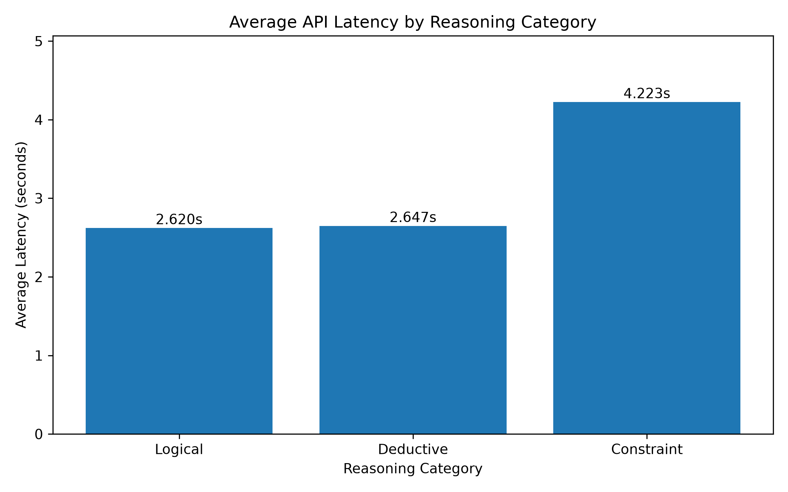
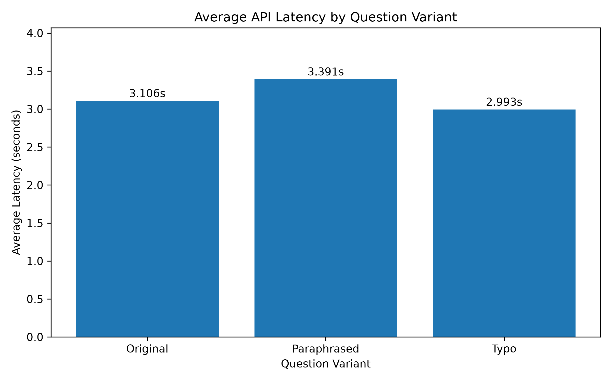

# Benchmarking Reasoning Problems in Large Language Models

A small-scale experimental project evaluating the performance of a large language model on reasoning tasks, with a focus on **answer accuracy, robustness to question wording, and API response latency**.

## 1. Project Overview

This project investigates how a language model performs across three types of reasoning problems:

- **Logical Reasoning:** Ordering and comparison problems.
- **Deductive Reasoning:** Drawing conclusions from given premises.
- **Constraint Satisfaction:** Solving problems under multiple conditions.

The experiment also examines whether paraphrasing or introducing minor typographical errors affects model performance.

## 2. Research Questions

1. How accurately does the evaluated model answer different types of reasoning questions?
2. Does changing the wording of a question affect answer accuracy?
3. How does API response latency vary across reasoning categories and question variants?

## 3. Dataset

The benchmark consists of **15 base reasoning problems**, divided equally among three categories.

Each problem has three variants:

- **Original:** The initial question.
- **Paraphrased:** A semantically equivalent rewording.
- **Typo:** A version containing minor spelling errors.

This produces a total of **45 evaluation prompts**.

| Reasoning Category | Base Problems | Total Prompts |
|---|---:|---:|
| Logical | 5 | 15 |
| Deductive | 5 | 15 |
| Constraint | 5 | 15 |
| **Total** | **15** | **45** |

The questions and reference answers are stored in `questions.csv`.

## 4. Experimental Method

The benchmark was implemented in Python and executed through the Google Generative AI API.

For each question, the system:

1. Reads the question and multiple-choice options from the dataset.
2. Sends a prompt to the language model.
3. Extracts the selected answer (A, B, C, or D).
4. Compares the prediction with the reference answer.
5. Records the evaluation result, API response latency, and execution timestamp.

The benchmark runner also includes retry handling for temporary API failures and supports resuming interrupted experiments.

Results are saved in `results/experiment_results.csv`.

## 5. Experimental Results

The evaluated model achieved an overall accuracy of **100% (45/45)**.

### Accuracy by Reasoning Category

| Category | Correct / Total | Accuracy |
|---|---:|---:|
| Logical | 15/15 | 100% |
| Deductive | 15/15 | 100% |
| Constraint | 15/15 | 100% |

### Accuracy by Question Variant

| Variant | Correct / Total | Accuracy |
|---|---:|---:|
| Original | 15/15 | 100% |
| Paraphrased | 15/15 | 100% |
| Typo | 15/15 | 100% |

No API errors or unparseable responses were recorded in the final experimental run.

### API Response Latency

The overall average response latency was **3.163 seconds**.

| Category | Average Latency |
|---|---:|
| Logical | 2.620 s |
| Deductive | 2.647 s |
| Constraint | 4.223 s |

| Variant | Average Latency |
|---|---:|
| Original | 3.106 s |
| Paraphrased | 3.391 s |
| Typo | 2.993 s |

### Visualizations

**Average API Latency by Reasoning Category**



**Average API Latency by Question Variant**



## 6. Discussion

The model answered all evaluated questions correctly, including paraphrased and typo-modified versions.

Constraint satisfaction questions showed higher average API latency than logical and deductive reasoning questions. Paraphrased questions also had slightly higher average latency than original and typo-modified questions.

However, these differences are descriptive observations from a single experimental run. API response latency may reflect network conditions and service-side processing rather than reasoning difficulty alone.

## 7. Limitations

- The dataset contains only 15 unique reasoning problems.
- The three variants of each problem are related and should not be treated as independent tasks.
- The questions are relatively simple, resulting in a ceiling effect in accuracy.
- Only one language model was evaluated.
- Each question variant was tested once.
- API latency does not directly measure internal reasoning time.

The results therefore describe performance on this specific benchmark rather than general reasoning ability.

## 8. Future Work

Future improvements may include:

- Expanding the dataset with more challenging reasoning problems.
- Evaluating multiple language models.
- Repeating experiments to assess response variability.
- Measuring consistency across different prompt formulations.
- Investigating more detailed error patterns when incorrect answers occur.

## 9. Technologies Used

- Python
- Google Generative AI API
- CSV
- Matplotlib

## 10. Project Structure

```text
LLM-Reasoning-Benchmark/
├── README.md
├── questions.csv
├── run_benchmark.py
├── analyze_results.py
├── main.py
├── test_api.py
└── results/
    ├── experiment_results.csv
    └── charts/
        ├── latency_by_category.png
        └── latency_by_variant.png
```

## 11. Reproducing the Analysis

To reproduce the analysis using the included experimental results:

1. Install Python and Matplotlib.
2. Run:

```bash
python analyze_results.py
```

The script prints accuracy and latency summaries and generates the two visualization files in `results/charts/`.

Running a new benchmark experiment requires valid API credentials and may incur API usage costs.

---

**Project Type:** Independent Research / Experimental Benchmarking

**Research Area:** Large Language Models, Reasoning Evaluation, Prompt Robustness